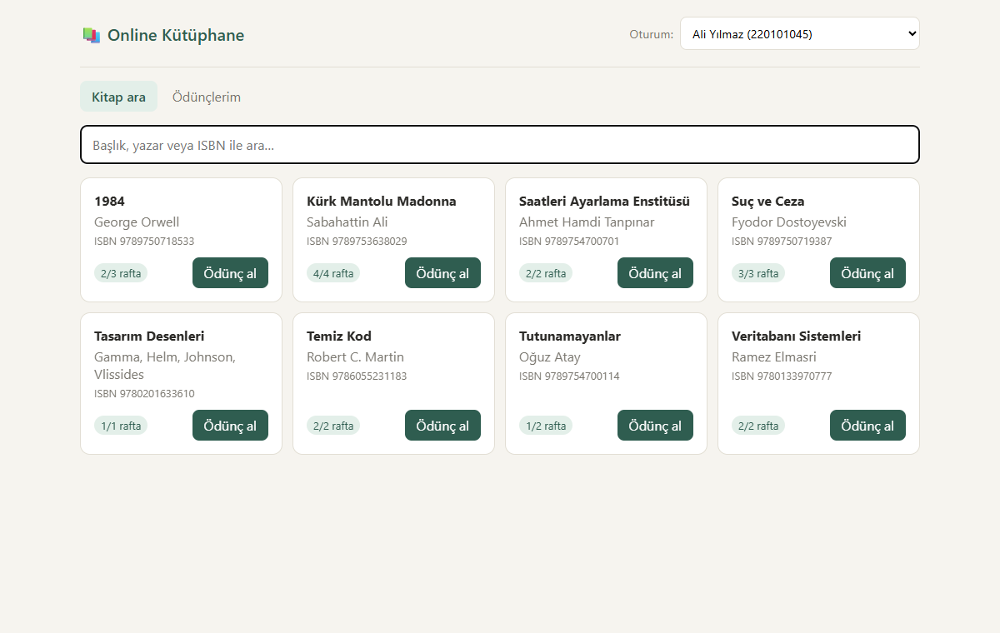
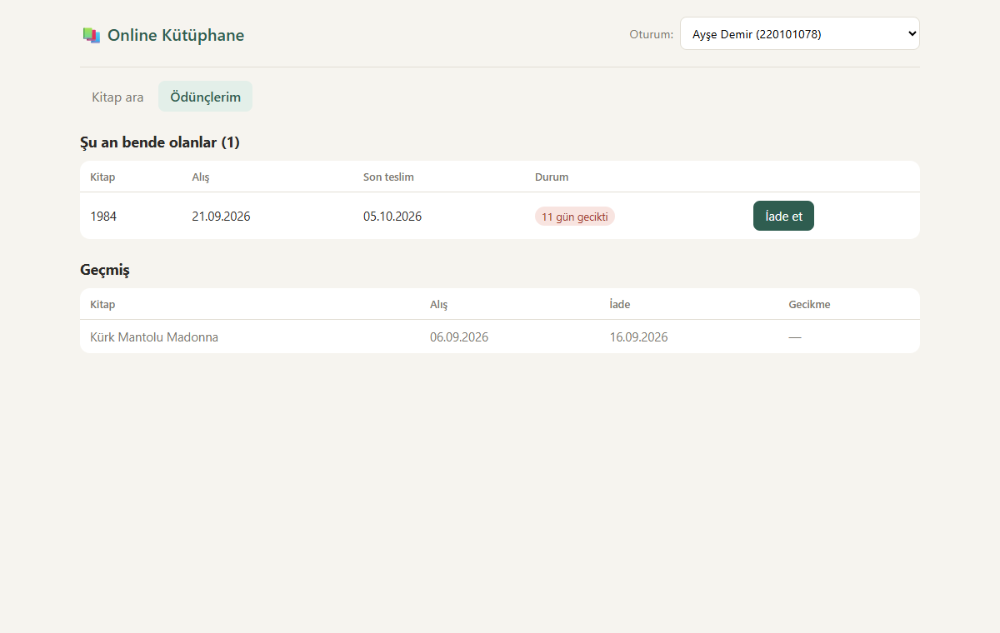
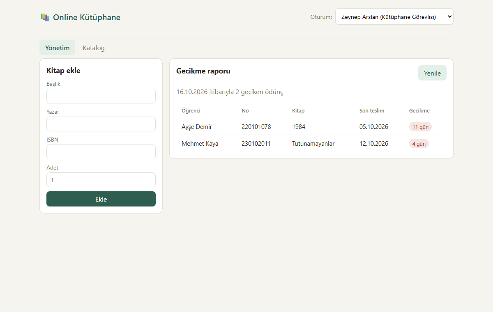
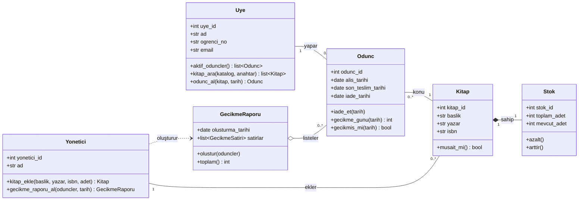
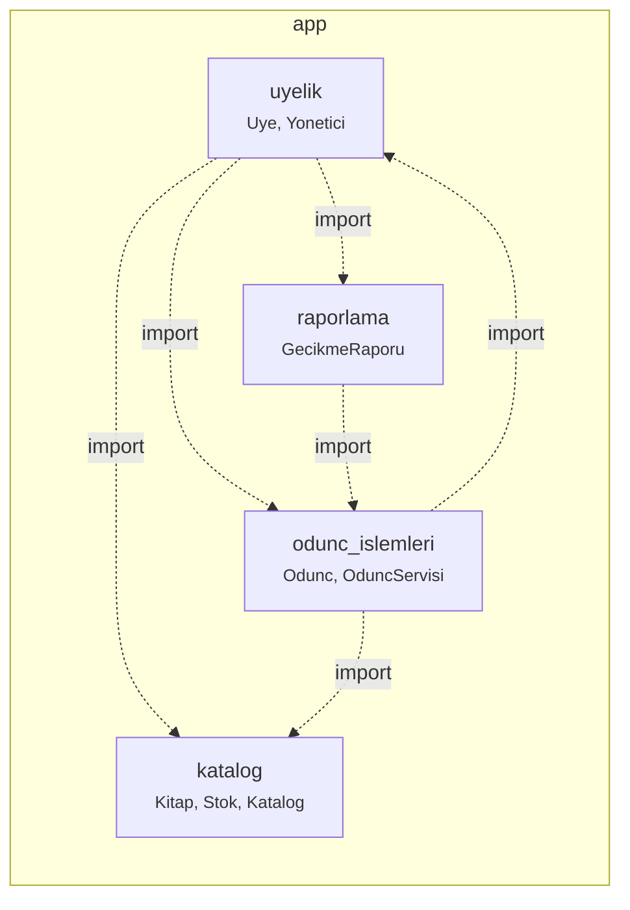
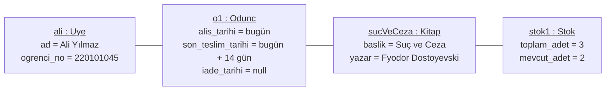
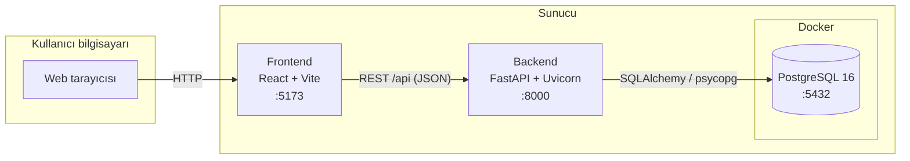

# Online Kütüphane Yönetim Sistemi

Öğrencilerin kitap arayıp ödünç alabildiği, yöneticinin kitap ekleyip gecikmeleri takip edebildiği
bir web uygulaması. Ders projesi olarak UML diyagramlarına (Class, Package, Object, Deployment)
birebir uyacak şekilde tasarlanmıştır.

**Teknolojiler:** Python (FastAPI + SQLAlchemy) · React (Vite) · PostgreSQL (Docker)

## Özellikler

| Rol | Yapabildikleri |
|-----|----------------|
| Öğrenci | Başlık / yazar / ISBN ile kitap arama, raftaki kopya sayısını görme, ödünç alma, iade etme, ödünç geçmişi |
| Yönetici | Stok adediyle kitap ekleme, gecikme raporu |

## Ekran görüntüleri

**Kitap arama (öğrenci):** Rafta kaç kopya kaldığı görünür, kopya kalmadıysa ödünç alma düğmesi kapanır.



**Ödünçlerim (öğrenci):** Elindeki kitaplar, son teslim tarihi, gecikme durumu ve geçmiş.



**Yönetim (yönetici):** Kitap ekleme formu ve en çok gecikenden başlayan gecikme raporu.



**İş kuralları** ([backend/app/ayarlar.py](backend/app/ayarlar.py) dosyasından değiştirilebilir):

- Ödünç süresi 14 gündür.
- Bir öğrenci aynı anda en fazla 3 kitap tutabilir.
- Aynı kitap aynı öğrencide iki kez olamaz.
- Rafta kopya kalmadıysa ödünç verilmez.
- Aynı ISBN ile ikinci kitap eklenemez.

## Hızlı başlangıç

Gerekenler: Python 3.11+, Node.js 18+, Docker Desktop.

```bash
# 1. Veritabanı (proje kök klasöründe)
docker compose up -d

# 2. Backend (yeni terminalde)
cd backend
python -m venv .venv
.venv\Scripts\Activate.ps1        # macOS / Linux: source .venv/bin/activate
pip install -r requirements.txt
uvicorn app.main:app --reload

# 3. Frontend (yeni terminalde)
cd frontend
npm install
npm run dev
```

- Uygulama: http://localhost:5173
- API dokümantasyonu (Swagger): http://localhost:8000/docs

İlk çalıştırmada tablolar ve örnek veriler (3 öğrenci, 1 yönetici, 8 kitap) otomatik oluşur.
Üst çubuktaki **Oturum** listesinden öğrenci ya da yönetici seçerek rol değiştirebilirsin.
Ders projesi olduğu için şifreli giriş yoktur.

Docker olmadan çalıştırmak, sık karşılaşılan hatalar ve tüm dosyaların açıklaması için
[KURULUM_REHBERI.md](KURULUM_REHBERI.md) dosyasına bak.

## Testler

```bash
cd backend
pytest
```

Testler geçici bir SQLite veritabanı kullanır, PostgreSQL gerektirmez.

## Proje yapısı

```
├── docker-compose.yml        PostgreSQL
├── backend/
│   ├── app/
│   │   ├── main.py           Uygulamanın giriş noktası
│   │   ├── api.py            REST uç noktaları
│   │   ├── uyelik/           Paket: Uye, Yonetici
│   │   ├── katalog/          Paket: Kitap, Stok
│   │   ├── odunc_islemleri/  Paket: Odunc
│   │   └── raporlama/        Paket: GecikmeRaporu
│   └── tests/
└── frontend/
    └── src/
        ├── App.jsx
        └── sayfalar/         Katalog, Ödünçlerim, Yönetim ekranları
```

`uyelik`, `katalog`, `odunc_islemleri` ve `raporlama` klasörleri Package Diagram'daki dört pakete karşılık gelir.
Class Diagram'daki metotlar sınıfların içinde aynı adla yazılmıştır
(`Uye.odunc_al()`, `Odunc.iade_et()`, `Stok.azalt()`, `Yonetici.kitap_ekle()` …).

## UML diyagramları

Aşağıdaki diyagramlar koddan çıkarılmıştır; sınıf, metot ve paket adları koddakilerle aynıdır.

### Class Diagram



- **Odunc**, Uye ile Kitap arasındaki ilişki sınıfıdır. Ödünç tarihi, son teslim tarihi ve iade tarihi burada tutulur.
- **Kitap ◆— Stok** bir composition ilişkisidir: kitap silinirse stoğu da silinir.
- **GecikmeRaporu ◇— Odunc** bir aggregation ilişkisidir: rapor ödünçleri listeler ama onlara sahip değildir ve veritabanında saklanmaz.

### Package Diagram



### Object Diagram

Örnek verideki senaryo: Ali Yılmaz, 3 kopyası olan "Suç ve Ceza"yı bugün ödünç alıyor.



### Deployment Diagram



## API uç noktaları

| Yöntem | Yol | Ne yapar |
|--------|-----|----------|
| GET | `/api/kitaplar?q=` | Kitap arar |
| POST | `/api/kitaplar` | Yönetici kitap ekler |
| POST | `/api/oduncler` | Öğrenci kitap ödünç alır |
| POST | `/api/oduncler/{id}/iade` | Kitabı iade eder |
| GET | `/api/uyeler/{id}/oduncler` | Öğrencinin ödünçleri |
| GET | `/api/raporlar/gecikme?yonetici_id=` | Gecikme raporu |
| GET | `/api/uyeler`, `/api/yoneticiler` | Kullanıcı listeleri |
